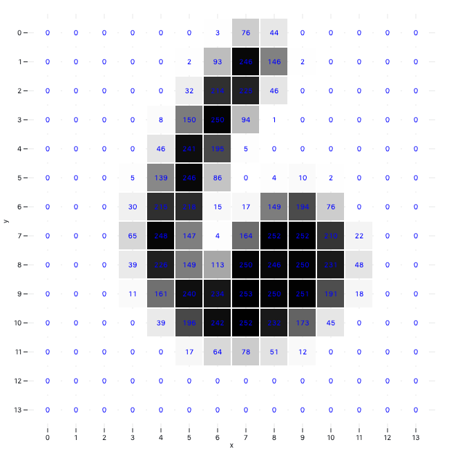
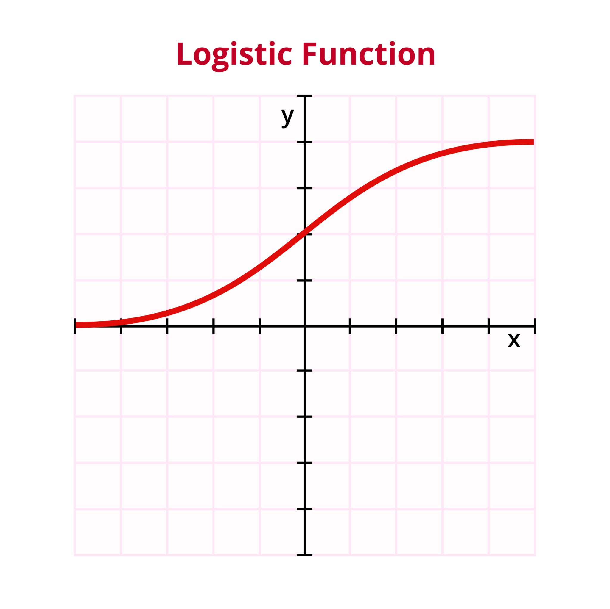
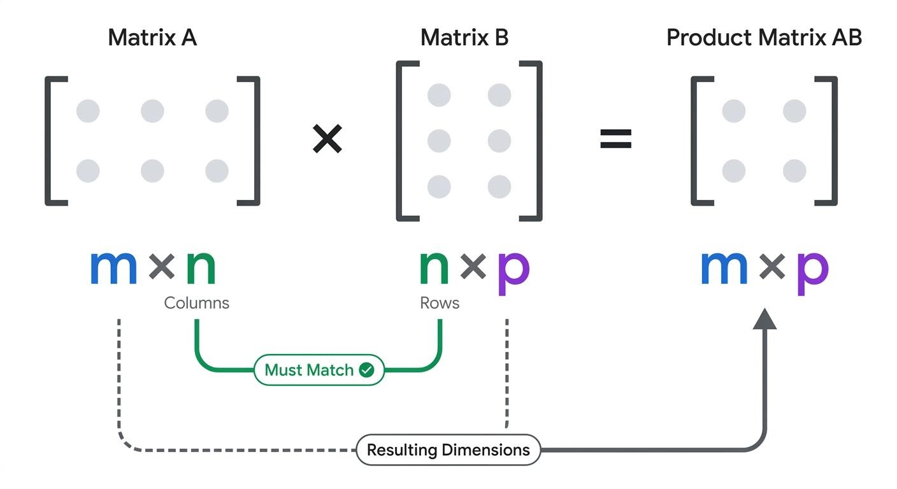

```
title: 大数据集的矩阵乘法
description: 记录矩阵乘法，因为本人总是忘记
pubDate: 2026-11-08
```

在学习逻辑回归一章中作者用MNIST数据集来演示，数据集很好理解，是n * 785的结构，每行的开头是样本的真实数字，剩下的784行是（28 * 28）的像素表示

为了让机器分辨图像，用一个直觉的方法，让机器根据每个像素的值做计算（0-255），数值越大颜色越深。因为每个数字分布位置不一样，所以求出来的值也不一样



简化我们的目标，先分辨8和4两个数字，我们让图像是8的时候算出来结果为0，图像是4的时候计算结果为1

计算出来的结果用 **Sigmoid 函数**放缩至0-1之间



给每个像素块不同的权重，每个像素块和权重相乘，最后再加个bias就得到了初始分数，最后归一化，原理非常简单，编程中把他写成矩阵相乘的形式，按下面的图中，m是1，p也是1，这样算出来就是一个数（1 * 1）的矩阵

m可以看作是数据总量（有多少张图片），p可以看作是有几份不同权重（个人理解）



python编程写法

```py
for i in rand_idxs:
        h = x[i, :]@w + b
        a = str(1/(1+np.exp(-h)))
        result = str(y[i])
        print("Actual result is "+ result + ", prediction is " + a)
```

## 总结

大一时学的线性代数去看了3Blue1Brown才比较全面的了解线性代数的几何意义（旋转，维度...），不过我已经忘光了，我本人强迫症比较严重，喜欢几何意义上理解数据，但在机器学习中基本上当做计算理解就可以了


