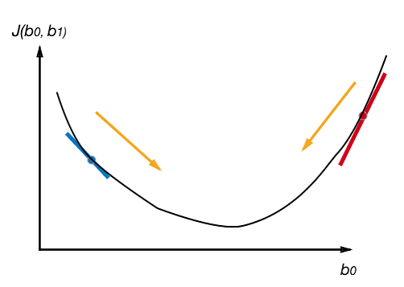

[📥 本次实验完整代码](/blog/files/Regression.ipynb)

损失函数有非常多种，比如中学时的平方差，均方差

机器学习中一般用 binary cross entropy 

记真实结果为 a，预测结果为 y，那两者之间的差别我们用 **binary cross entropy loss** 来测量。
$$
L = - \Big( y \cdot \log(a) + (1 - y) \cdot \log(1 - a) \Big)
$$
比如，当结果是 y=0，预测是 a=1 的时候，损失是：
$$
L = −\Big(0\cdot \log(1) − 1\cdot \log(0.001)\Big)
$$

其中
$$
a = \frac{1}{1 + e^{-h} }
$$

$$
h = w^T \cdot x + b
$$

$$
\frac{\partial L}{\partial w} = \frac{\partial L}{\partial a} \cdot \frac{\partial a}{\partial h} \cdot \frac{\partial h}{\partial w}
$$

$$
\frac{\partial L}{\partial a} = \frac{a - y}{a (1-a)}
$$

$$
\frac{\partial a}{\partial h} = a(1-a)
$$

$$
\frac{\partial h}{\partial w} = x
$$

<------所以------>
$$
\frac{\partial L}{\partial w} = x(a-y)
$$
我们的目的就是调整w，使得损失函数L最小

同理算一下b的梯度
$$
\frac{\partial L}{\partial b} = \frac{\partial L}{\partial a} \cdot \frac{\partial a}{\partial h} \cdot \frac{\partial h}{\partial b}
$$

$$
\frac{\partial h}{\partial b} = 1
$$

$$
\frac{\partial L}{\partial b} = a-y
$$


导数就是参数变化对函数值的影响，假设导数值是100，简单理解就是参数w多0.1，那损失就要加100，如果是-100，那参数多0.1损失就小100，所以参数的变化要和导数反着来，做到让导数为0，这样就取得了局部最值

(width: 500)


现在用py实现这个让Loss下降的任务

```py
epochs = 20 # 调整轮次
alpha = 1 # 步长 步长一般是0.01这种量级，这里数据特殊所以比较大
loss_prev = 10e6 # 初始化一个很大的损失

w = np.random.rand(m) # 随机w权重和b权重
b = np.random.rand() 

for epoch in range (epochs):
    # x: n * 784, w:784 * 1, b:1
    # h: n * 1
    a = x@w + b

    # a: n * 1 n个样本
    a = 1 / (1 + np.exp(-a))

    # 避免log(0)的情况
    a = np.clip(a, .001, .999)

    # y: n * 1, a - y: n * 1, x.T: 784 * n
    # w: 784 * 1
    # y: n * 1, a - y: n * 1, x.T: 784 * n
    # w: 784 * 1
    w -= alpha * (x.T@(a-y)) / len(y) # T是转置，因为w是784个参数 后面这个就是梯度
    
    # 所有数据针对 b 的梯度下降取平均值，因为a 和 y是个向量
    b -= alpha * np.mean(a - y)

    loss = - np.sum(y*np.log(a) + (1-y)*np.log(1-a))
    loss_reduction = loss_prev - loss
    loss_prev = loss

    accuracy = sum((a > 0.5).astype(int) == y) / len(y)

    print('第', epoch+1, '轮', ' 损失为 {:.7}'.format(loss), \
          ' 该轮中损失减少了 {:.7}'.format(loss_reduction), \
          ' 正确识别率为 {:.4%}'.format(accuracy)
        )
```

```py
第 1 轮  损失为 40423.12  该轮中损失减少了 9.959577e+06  正确识别率为 49.9615%
第 2 轮  损失为 40422.38  该轮中损失减少了 0.7435969  正确识别率为 49.9615%
第 3 轮  损失为 15959.55  该轮中损失减少了 24462.83  正确识别率为 66.5954%
第 4 轮  损失为 14788.46  该轮中损失减少了 1171.084  正确识别率为 69.3663%
第 5 轮  损失为 9656.029  该轮中损失减少了 5132.434  正确识别率为 78.6197%
第 6 轮  损失为 9261.233  该轮中损失减少了 394.7956  正确识别率为 77.2171%
第 7 轮  损失为 6265.506  该轮中损失减少了 2995.727  正确识别率为 85.6153%
第 8 轮  损失为 5554.407  该轮中损失减少了 711.0995  正确识别率为 84.4180%
第 9 轮  损失为 4261.278  该轮中损失减少了 1293.129  正确识别率为 89.2329%
第 10 轮  损失为 3776.03  该轮中损失减少了 485.2482  正确识别率为 89.3612%
第 11 轮  损失为 3268.684  该轮中损失减少了 507.3458  正确识别率为 91.0887%
第 12 轮  损失为 2939.985  该轮中损失减少了 328.6988  正确识别率为 91.7301%
第 13 轮  损失为 2655.277  该轮中损失减少了 284.7079  正确识别率为 92.6195%
第 14 轮  损失为 2426.073  该轮中损失减少了 229.2038  正确识别率为 93.1840%
第 15 轮  损失为 2234.767  该轮中损失减少了 191.3068  正确识别率为 93.6629%
第 16 轮  损失为 2075.284  该轮中损失减少了 159.4826  正确识别率为 94.1846%
第 17 轮  损失为 1939.318  该轮中损失减少了 135.9657  正确识别率为 94.5608%
第 18 轮  损失为 1823.234  该轮中损失减少了 116.0844  正确识别率为 94.8174%
第 19 轮  损失为 1722.66  该轮中损失减少了 100.5741  正确识别率为 95.1338%
第 20 轮  损失为 1634.584  该轮中损失减少了 88.07614  正确识别率为 95.4674%
```

测试集验证（拿test数据集中的所有8和4来验证我们参数的效果）

```py
test_labels = [8, 4]
indices = np.where(np.isin(y_test, test_labels))[0]

x = x_test[indices]
y = y_test[indices]

# 如果数字是 8， 我们把它变成 0
y[y == test_labels[0]] = 0

# 如果数字是 4， 我们把它变成 1
y[y == test_labels[1]] = 1

h = x@w + b
a = 1/(1+np.exp(-h))
accuracy = sum((a > 0.5).astype(int) == y)/len(y)
print(' 正确识别率为 {:.4%}'.format(accuracy))
```

```py
 正确识别率为 96.2679%
```


