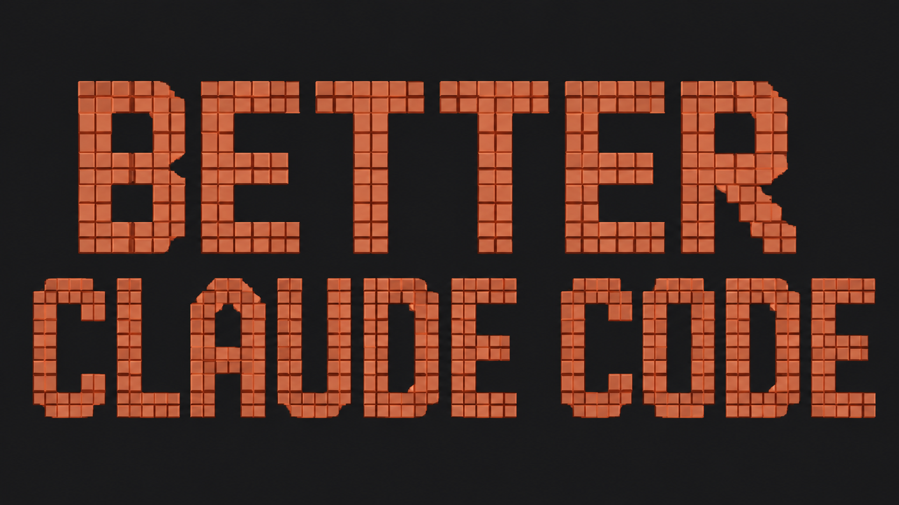
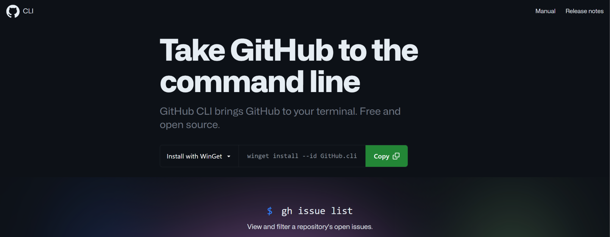
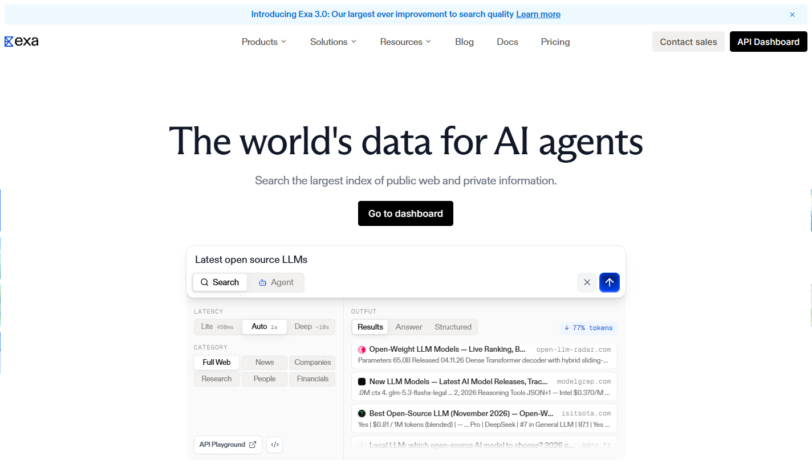
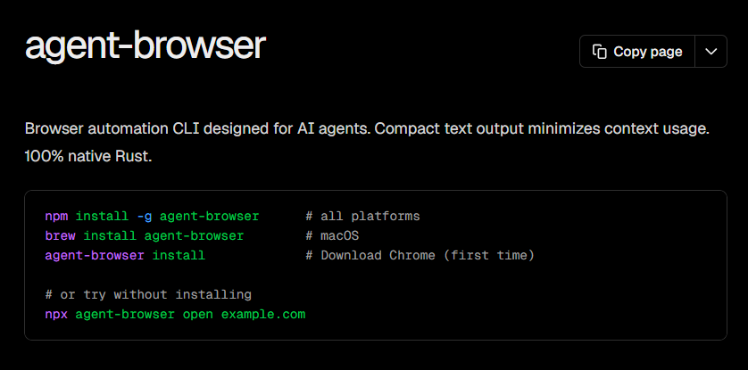
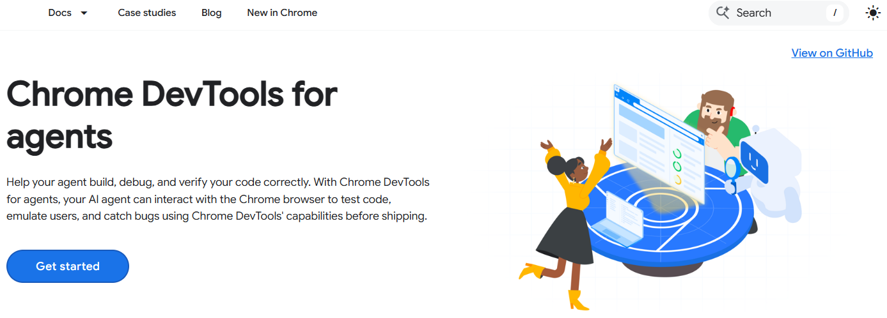
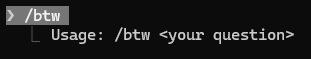

我不是一个优秀的程序员，几乎不会手写代码（古法编程）。但用了这么久的 Agent 之后，我确实攒下一些自己的心得——这些技巧实实在在地增强了 Agent 的能力，我相信它们也能帮到别人。



## 目录

1. [模型选用](#一模型选用)
2. [Skill](#二skill)
3. [Plugin 和外部工具 Tool](#三plugin-和外部-tool)
4. [好用命令 /btw](#四好用命令btw)
5. [全局 CLAUDE.md](#五全局-claudemd)

用好 Agent 主要在三个方面：模型选用、Skill、插件和工具。

可能有人疑惑我为什么不谈 Agent 该怎么选——Claude Code、Codex、DeepSeek Harness、Cursor、Qoder 这么多。原因很简单：这里面只有一个断档领先的选手，就是 Claude Code。Anthropic 是一家以编程为核心目标的公司，Agent 也是他们最先做出来的，模型和 Agent 都是断档式领先，这点应该没人否认。从我的使用体验看，其他 Agent 只能达到 Claude Code 六成的水平，所以默认我只选 Claude Code。当然，你更喜欢别的 Agent 完全没问题——哪个用起来最顺手，哪个就是最好的。

## 一、模型选用

模型是最关键的选择。一个聪明的模型会自我增强，懂得调用一切能用的工具——可以说，选好模型是成败的关键。

Agent 玩家不是只和大模型聊天——我们要的是让它干活（打工），比如编程、做 PPT、写 Word。所以选 Agent 模型，最该关注的是干活能力，而不是对话能力。干活速度快、质量高、废话少，这是三大要求。

因此我只推荐两家公司的模型：有 💰 的选手上 Claude Opus，平价选手上 GLM。

Anthropic 和智谱都是以编程为训练目标的公司，它们的模型完美符合上面三个要求。

> 大模型做不成六边形战士，每家都有自己的侧重点。比如 Claude 编程能力强；Gemini 对话体验好，说话有人味，前端审美好；GPT 自称六边形战士，但事实上每个方面都不精通。

我推荐 GLM-5.3-flash。当初选它纯粹是因为最便宜，结果发现效果非常好。官网价格是 0.8 元每百万输入，中转站一般还能更便宜。

各家模型使用体验：

- GPT：喜欢列计划，编程累赘，代码不精简，防御性编程太多，说话没人味，输出要点分散，像拉稀

- DeepSeek：优点是说话礼貌对话尚可，输出结构化便于阅读；缺点是很笨，不懂得调用Agent工具，工程能力极差

- GLM：很像Claude，懂我意图，干活能力强，废话少，体验极好，大工程能力不及Opus，但小项目完全够用

- MiniMax：强于DeepSeek，弱于GLM，给我一种乏善可陈的感觉

## 二、Skill

Skill 就是 Prompt。我只推荐一个 Skill——/grill-me。

想出这个 Skill 的人绝对是个天才。下面是它的 SKILL.md全文：

```
name: grill-me

description: Grill the user relentlessly about a plan, decision, or idea. Use when the user wants to stress-test their thinking, or uses any 'grill' trigger phrases (e.g. "grill me", "拷问我", "poke holes in my plan").

Interview me relentlessly about every aspect of this until we reach a shared understanding. Walk down each branch of the decision tree, resolving dependencies between decisions one-by-one. For each question, provide your recommended answer.

Ask the questions one at a time, waiting for feedback on each question before continuing. Asking multiple questions at once is bewildering.

If a *fact* can be found by exploring the environment (filesystem, tools, etc.), look it up rather than asking me. The *decisions*, though, are mine — put each one to me and wait for my answer.

Do not act on it until I confirm we have reached a shared understanding.
```

AI 的生成是概率结果，方案没提前定好，很容易得到不想要的结果。这个技能正好解决「方案选择」的问题——比如做这个博客时，它就逐项问我：技术方案选 Astro / Hugo / WordPress？域名自购还是用 GitHub Pages？

如今 AI 的设计趋势，是用更少的提示词构建更准确的结果，每一次 Claude 迭代都在简化全局提示词。我一开始也做了一大堆 Skill，用得多，后来基本都放着吃灰了——只有 grill-me 还会用。

## 三、Plugin 和外部 Tool

Claude Code 内置了不少工具，比如读 PPT 和 Word、网络搜索等，但都不算好用，所以开发者圈子一直在插件和外部工具这块努力。

推荐几个插件和工具，都在实时解决 Claude Code 本身的痛点。

**GitHub CLI（gh）**
  - 装了它以后，Claude 提 PR、查 Issue、管理仓库全部用命令完成，再也不用你去点 GitHub 网页
  - 创建 PR 只需一条命令，描述还能自动生成，不用手写
  - Issue 的查看、搜索、评论也全在终端里完成
  - Claude 可以直接读 CI 的构建结果和失败日志，不用你自己去网页上翻
  - 支持 GitHub 全家桶：仓库、Release、Gist、Actions 都能操作
  - 一切都能转化成 CLI 命令，交给 Claude 自动执行
  - <http://cli.github.com/>



**exa**
  - Claude 内置搜索经常搜到过时、没用的内容；换成 exa 后搜出来的东西又全又新，深度研究一个话题终于够用了
  - 返回结果自带 highlights 摘要，不用逐个点开网页就能判断哪篇有用
  - 对技术类查询尤其准，找文档、找博客、找 GitHub 项目都很好用
  - 支持一次批量抓取多个 URL 的正文内容
  - 深度研究模式下能自动多轮搜索、交叉验证，再汇总成结果
  - 需要登录使用
  - [访问 exa](https://exa.ai/)



**agent-browser**
  - Claude 内置浏览器只能跑小项目，碰到需要你登录状态的网站就没辙；agent-browser 直接操作你真实的 Chrome，登录态直接复用
  - Rust 构建，原生 CLI，启动快、响应快
  - 一条命令能串多个动作（batch），token 开销比 chrome-devtools 低约 10 倍
  - snapshot 直接输出页面的结构化文本，不用截图就能定位元素
  - 能连上你已经开着调试端口的 Chrome，接着你正在看的页面继续操作
  - 还有网络 mock、HAR 录制、录屏、多会话并行这些独有功能
  - [项目地址](https://github.com/vercel-labs/agent-browser)



**chrome-devtools**
  - agent-browser 干不了前端调试的细活，得靠它：性能追踪、Lighthouse 审计、CSS 级联检查、内存堆快照
  - 性能追踪能直接给出 LCP、INP 等核心指标和优化建议
  - Lighthouse 一键跑完无障碍、SEO、最佳实践的完整审计
  - CSS 检查能看到被覆盖的规则，排查样式问题不用开 DevTools 面板
  - 功能全但慢、token 贵，只在调前端时才切过去用
  - 现在已经改成 Claude Code Plugin
  - [项目地址](https://github.com/ChromeDevTools/chrome-devtools-mcp)



## 四、好用命令/btw

有时候AI的回答中有一些我们不理解的，但是又不愿意再发一次问题增加上下文让自己看的不方便，那么可以使用/btw，这个命令会读取会话上下文但是不会增加进去，模型在工作的时候也可以使用



## 五、全局 CLAUDE.md

工具装上之后，Claude 还是会偏向使用自己内置的工具，所以要在全局提示词里强制指定。这是我的部分 CLAUDE.md 全局设置：

```md
网络搜索优先使用 **exa MCP 工具**（`mcp__plugin_exa_exa__web_search_exa`），而不是内置的 `web_search`。exa 的搜索结果质量更高、提供的 highlights 更有价值，适合深度研究和复杂查询。只有在 exa 不可用或明确不适合时，才退回 `web_search`。

  - 默认一律用 agent-browser CLI（走 Bash），不要用 chrome-devtools MCP：它一条 Bash 能批量串多个动作（`batch` 子命令），避开 MCP 每个动作一次模型往返的开销，实测 token 开销低约 10 倍。
  - 只在四个场景切回 chrome-devtools MCP（agent-browser 没有这些）：性能追踪 Insight 解读（performance_start_trace）、Lighthouse 审计（lighthouse_audit）、CSS 级联检查（get_css_styles，能看被覆盖规则）、堆快照（take_heapsnapshot）。
  - agent-browser 独有而 chrome-devtools MCP 没有的，需要时直接用：网络 mock（`network route`）、HAR 录制、视频录制（`record`）、多会话并行、Core Web Vitals（`vitals`）、axe-core 无障碍审计（`a11y`）。
```

## 更新日志

- 2026-11-10 初版

我的分享就到这里，会持续更新。如果对你有用，欢迎点个赞或者 star 一下 😁
