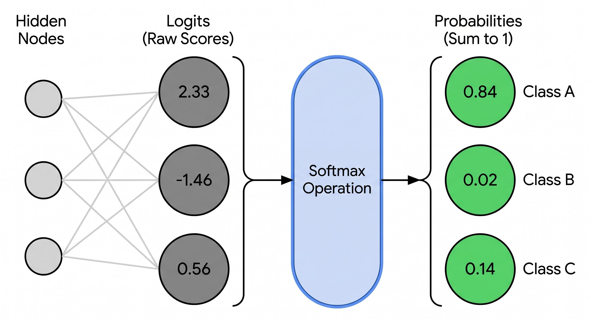

上一篇是逻辑回归识别图像，这次学习神经网络。目标都是MNIST数据集

先回顾下逻辑回归的方法：我们用线性wx + b的形式计算每个像素的值，分数记为0 / 1，以此来区分8和4两个数字，问题是如果需要识别的是[0 - 9] 10个数字，如果扩展一下我们可能要分为1 - 10 10个数值，调整参数让计算的结果能分成10份来识别数字。但这有一个显然的直觉问题，我们的参数太少了，如果要识别10个不同的类别，无论怎么调整784个参数，肯定是难以区分开分数的（我没有实践过，但是读者应该也能大致领会这个意思）

因此增加参数是一个显然的方向，比如给每个色块多加几个维度的参数，进行多次的一元方程相加，w2(w1x + b1) + b2用多参数来更好区分10种数字的色块。每个节点类似于一个神经元，这是神经网络的一种简化构想。

## 激活函数-Sigmoid函数

第一层的第一个神经元数据怎么算的：第零层每一个神经元的数据乘以其与第一层第一个神经元的权重，结果再加上第一层的第一个神经元对应的偏差 (bias)。这样算出来的结果从负无穷到正无穷都有可能。我们需要把这个初始结果转化为我们想要的结果，这个转化的函数被称为激活函数 (activation function)

为什么需要激活函数？

在神经网络的第零层（输入层，比如 MNIST 手写数字的 784 个像素）传到第一层（隐藏层）时，计算机做的是一个**线性组合**：
$$
\text{初始结果 } z = \text{权重 } w \times \text{输入 } a + \text{偏差 } b
$$
线性运算（比如加法、乘法）有一个巨大的局限：**无论你叠加多少层线性计算，它本质上都等价于单层线性模型**。它无法处理复杂的、非线性的现实世界问题（比如识别手写数字中各种弯曲的线条、闭合的圆圈等）。

因此，我们需要用一个“非线性”的函数把这个初始结果 $z$ 重新加工一下——这个加工函数，就叫做**激活函数**。

文章里在不同层之间选用了不同的激活函数：

- **Sigmoid 函数（用于第零层 -> 第一层）**
	- **作用**：把刚才算出来的、可能从负无穷到正无穷的初始结果 $z$，**压缩映射到 $(0, 1)$ 的区间内**。
	- **特点**：它像一个“平滑的门控”，输出可以被看作是一种概率或者特征的激活强度。
- **Softmax 函数（用于第一层 -> 第二层 / 输出层）**
	- **作用**：因为我们要识别的是数字 0 到 9，最后需要输出 10 个数字各自对应的**概率**，并且这 10 个概率加起来的总和必须等于 1。
	- **特点**：Softmax 能够把最后一层的多个原始输出值转化为归一化的概率分布，非常适合多分类任务。
	- 如果只有二分类，Softmx就退化为Sigmoid了
	- 

## 公式人话翻译

$$
z^{(1)} = w^{(1)}a^{(0)} + b^{(1)}
$$

第一层的神经元数值 = 第一层神经元参数 * 第0层参数（784初始值）+ 第一层偏置

$$
a^{(1)} = \sigma(z^{(1)})
$$
激活函数激活一下，把 R 的值域转为0 - 1

第二层也一样

$$
z^{(2)} = w^{(2)}a^{(1)} + b^{(2)}
$$

$$
a^{(2)} = S(z^{(2)})
$$

损失函数 cross entropy loss
$$
L = - \sum^{c}_{k=1} y_k \log (a^{(2)}_k)
$$

$$
a^{(i)}_j表示第 
i
 层的第 
j
 个神经元。
z
(
i
)
j
 也一样。需要注意的是 
i
、
j
 都是从 
0
 开始计数。
$$

$$
y_k
 表示真实结果为 
k
 的概率。
$$

求损失函数公式对w b 参数的求导
$$
\begin{aligned} \frac{\partial L}{\partial z^{(2)}_i} & = \frac{\partial \left( - \sum^{c}_{k=1} y_k \log (a^{(2)}_k) \right)}{\partial z^{(2)}_i} \\ & = - \sum^{c}_{k=1} y_k \cdot \frac{\partial \log (a^{(2)}_k)}{\partial z^{(2)}_i} \\ & = - \sum^{c}_{k=1} y_k \cdot \frac{\partial \log (a^{(2)}_k)}{\partial a^{(2)}_k} \cdot \frac{\partial a^{(2)}_k}{\partial z^{(2)}_i} \\ & = - \sum^{c}_{k=1} \frac{y_k}{a^{(2)}_k} \cdot \frac{\partial a^{(2)}_k}{\partial z^{(2)}_i} \\& = - \left( \frac{y_i}{a^{(2)}_i} \cdot a^{(2)}_i \cdot (1 - a^{(2)}_i) - \sum^{c}_{k=1, k \neq i} \frac{y_k}{a^{(2)}_k} \cdot a^{(2)}_k \cdot a^{(2)}_i \right) \\& = - y_i (1 - a^{(2)}_i) + \sum^{c}_{k=1, k \neq i} y_k a^{(2)}_i \\& = - y_i + y_i a^{(2)}_i + \sum^{c}_{k=1, k \neq i} y_k a^{(2)}_i \\& = - y_i + \sum^{c}_{k=1} y_k a^{(2)}_i \\& = a^{(2)}_i - y_i \end{aligned}
$$

$$
\frac{\partial z^{(2)}_i}{\partial w^{(2)}_{i j}} = \frac{\partial \sum^{h}_{j = 1} w^{(2)}_{i j} a^{(2)}_j}{\partial w^{(2)}_{i j}} = a^{(2)}_j
$$

得到损失函数对
$$
w^{(2)}_{i j}
$$
的偏导
$$
\begin{aligned} \frac{\partial L}{\partial w^{(2)}_{i j}} & = \frac{\partial L}{\partial z^{(2)}_i} \cdot \frac{\partial z^{(2)}_i}{\partial w^{(2)}_{i j}} \\ & = (a^{(2)}_i - y_i) a^{(1)}_j \end{aligned}
$$
上面这个结果的含义是说，损失函数的变化相对于

 w(2)ij (第一层第 j 个神经元与第二层第 i 个神经元之间的权重) 的变化率是 (a(2)i−yi)a(1)j。那我们不难想象，损失函数的变化相对于第一层 j 个神经元与第二层所有神经元权重之向量的变化率是一个 10×1的矩阵。w(2) 是一个 10×28 的矩阵，那我们用10×1的矩阵乘以转置后的 a(1)，得到一个 10×28 的矩阵。该矩阵 (i,j) 点上的值正好是损失函数的变化相对于 w(2)ij的变化率。
$$
\frac{\partial L}{\partial w^{(2)}} = (a^{(2)} - y) \cdot {a^{(1)}}^T
$$
算出L对
$$
\frac{\partial L}{\partial b^{(2)}}
$$
的偏导
$$
\begin{aligned} \frac{\partial L}{\partial b^{(2)}_{i}} & = \frac{\partial L}{\partial z^{(2)}_i} \cdot \frac{\partial z^{(2)}_i}{\partial b^{(2)}_{i}} \\ & = (a^{(2)}_i - y_i) \cdot 1 \\& = (a^{(2)}_i - y_i) \end{aligned}
$$
然后用相似的方法算出对第一层的偏导
$$
\begin{aligned} \frac{\partial L}{\partial w^{(1)}} & = \frac{\partial L}{\partial z^{(2)}} \frac{\partial z^{(2)}}{\partial a^{(1)}} \frac{\partial a^{(1)}}{\partial z^{(1)}} \frac{\partial z^{(1)}}{\partial w^{(1)}} \\ & = (a^{(2)}-y)w^{(2)}\sigma^{\prime} (z^{(1)})a^{(0)} \end{aligned}
$$

$$
\begin{aligned} \frac{\partial L}{\partial b^{(1)}} & = \frac{\partial L}{\partial z^{(2)}} \frac{\partial z^{(2)}}{\partial a^{(1)}} \frac{\partial a^{(1)}}{\partial z^{(1)}} \frac{\partial z^{(1)}}{\partial b^{(1)}} \\ & = (a^{(2)}-y)w^{(2)}\sigma^{\prime} (z^{(1)}) \end{aligned}
$$

## 动手实现

学习作者博客（郝鸿涛[《手写一个神经网络 (含公式推导)》](https://hongtaoh.com/cn/2023/04/26/nn/)），并发现错误改成了行向量形式（[修复 PR](https://github.com/hongtaoh/hongtaoh.github.io/pull/283)）：原文的单样本计算用列向量，训练输出有问题（loss 高达几十万且越训越大），改成行向量后解决了这个 bug。训练数据用的是 MNIST 的 csv 版本（mnist_train.csv / mnist_test.csv）。下面按 notebook 的顺序贴出每个 cell 的代码，读者可以直接复制粘贴复现。

导入依赖：

```python
import pandas as pd
import numpy as np
import matplotlib.pyplot as plt
```

数据准备：MNIST 的 csv 每行第一列是标签（0-9），后面 784 列是像素值（0-255）。读取时把像素归一化到 0-1，标签做 one-hot 编码，变成 (样本数, 10) 的矩阵：

```python
def data_loader(file):
    df = pd.read_csv(file)
    x = (df.iloc[:, 1:]/255.0).to_numpy()
    y = df.iloc[:, 0].to_numpy()
    '''one hot encoding for y
    y will be the dimension of (n, k) where n is the number of training instances
    and k is the number of classes (0-9)
    '''
    y = pd.get_dummies(y).to_numpy()
    return (x, y)

x, y = data_loader('./data/mnist_train.csv')
x_test, y_test = data_loader('./data/mnist_test.csv')
```

看一眼形状，训练集 59999 条、测试集 9999 条：

```python
x.shape, y.shape, x_test.shape, y_test.shape
# ((59999, 784), (59999, 10), (9999, 784), (9999, 10))
```

定义激活函数和网络结构。输入层 784 个神经元（每个像素一个），隐藏层 28 个神经元（对应图片 28×28 的边长，纯属好记），输出层 10 个神经元（0-9 各一个概率）。隐藏层用 Sigmoid，输出层用 Softmax：

```python
# derivative of sigmoid function
# https://medium.com/@DannyDenenberg/derivative-of-the-sigmoid-function-774446dfa462

## How sigmoid and softmax were derived:
# https://towardsdatascience.com/sigmoid-and-softmax-functions-in-5-minutes-f516c80ea1f9

## softmax and cross entropy derivative
# https://eli.thegreenplace.net/2016/the-softmax-function-and-its-derivative/

## number of units in the hidden layer
h = 28

# number of units in the input layer, i.e., 784
m = x.shape[1]

# number of classes, i.e., 10 (0-9)
k = y.shape[1]

def sigmoid(x):
    return 1 / (1 + np.exp(-x + 10e-10))

def sigmoid_derivative(o):
    return sigmoid(o) * (1 - sigmoid(o))

def softmax(x):
    # 减去每行最大值防止 exp 溢出
    expz = np.exp(x - x.max(axis=1, keepdims=True))
    return expz / np.sum(expz, axis = 1, keepdims=True)
```

核心的训练函数：对每条样本单独算前向传播和梯度，更新一次参数（SGD）。对照上面的推导公式看，`dcdb2 = a2 - y_i` 正好是推出来的那个漂亮结果 a(2) − y：

```python
def nnet(train_x, train_y, alpha, num_epochs, num_train, true_labels):
    # initiate parameters
    # w1: h * 784
    w1 = np.random.uniform(low=-1, high = 1, size = (h, m))
    # w2: 10 * h
    w2 = np.random.uniform(low=-1, high = 1, size = (k, h))
    # b1: h * 1
    b1 = np.random.uniform(low=-1, high = 1, size = (h, 1))
    # b2: 10 * 1
    b2 = np.random.uniform(low=-1, high = 1, size = (k, 1))
    
    # set a large number as the initial cost to be compared with in the 1st iteration
    loss_previous = 10e10
    
    for epoch in range(1, num_epochs + 1):
        # shuffle the dataset
        train_index = np.arange(num_train)
        np.random.shuffle(train_index)
        
        for i in train_index:
            x_i = train_x[i, :].reshape(1, -1)   # (1, 784)
            y_i = train_y[i, :].reshape(1, -1)   # (1, 10)

            z1 = x_i @ w1.T + b1.T               # (1, h)
            a1 = sigmoid(z1)                     # (1, h)

            z2 = a1 @ w2.T + b2.T                # (1, 10)
            a2 = softmax(z2)                     # (1, 10)

            dcdb2 = a2 - y_i                     # (1, 10)
            dcdw2 = dcdb2.T @ a1                 # (10, h)

            dcdb1 = (dcdb2 @ w2) * sigmoid_derivative(z1)   # (1, h)
            dcdw1 = dcdb1.T @ x_i                # (h, 784)

            w1 = w1 - alpha*dcdw1
            b1 = b1 - alpha*dcdb1.T              # 注意：dcdb1 是 (1,h)，要转置回 (h,1) 才能减 b1
            w2 = w2 - alpha*dcdw2
            b2 = b2 - alpha*dcdb2.T              # 同理 (1,10) → (10,1)

                     
        # the output of the hidden layer will be a num_train * h matrix
        out_h = sigmoid(train_x @ w1.T + b1.T)
        # the output of the output layer will be a num_train * k matrix
        out_o = softmax(out_h @ w2.T + b2.T)
                     
        predicted_labels = np.argmax(out_o, axis=1)
        
        loss = -np.sum(train_y * np.log(out_o + 10e-10)) / num_train
        loss_reduction = loss_previous - loss
        loss_previous = loss
        correct = sum(true_labels == predicted_labels)
        accuracy = (correct / num_train)
        print('epoch = ', epoch, ' loss = {:.7}'.format(loss), \
              ' loss reduction = {:.7}'.format(loss_reduction), \
              ' correctly classified = {:.4%}'.format(accuracy))
        
    return w1, b1, w2, b2

alpha = .1
num_epochs = 10
num_train = len(y)
w1, b1, w2, b2 = nnet(x, y, alpha, num_epochs, num_train, true_labels)
```

实际跑出来的输出：

```
epoch =  1  loss = 0.2340949  loss reduction = 1e+11  correctly classified = 93.1832%
epoch =  2  loss = 0.1964695  loss reduction = 0.0376254  correctly classified = 94.2299%
epoch =  3  loss = 0.1946751  loss reduction = 0.001794454  correctly classified = 94.1932%
epoch =  4  loss = 0.1583026  loss reduction = 0.03637248  correctly classified = 95.2516%
epoch =  5  loss = 0.1491368  loss reduction = 0.009165786  correctly classified = 95.4966%
epoch =  6  loss = 0.1531693  loss reduction = -0.004032452  correctly classified = 95.3416%
epoch =  7  loss = 0.135262  loss reduction = 0.0179073  correctly classified = 95.7816%
epoch =  8  loss = 0.1411744  loss reduction = -0.00591242  correctly classified = 95.7566%
epoch =  9  loss = 0.1526715  loss reduction = -0.01149711  correctly classified = 95.2916%
epoch =  10  loss = 0.1324962  loss reduction = 0.02017525  correctly classified = 95.8883%
```

第一个 epoch 从随机初始化开始就能到 93%，后面慢慢爬到 96% 左右。loss reduction 有正有负，说明 SGD 每条样本单独更新会有波动，但整体趋势是下降的。

测试集验证：

```python
def compute_accuracy(x_test, y_test, w1, b1, w2, b2):
    # the output of the hidden layer will be a num_train * h matrix
    out_h = sigmoid(x_test @ w1.T + b1.T)
    # the output of the output layer will be a num_train * k matrix
    out_o = softmax(out_h @ w2.T + b2.T)

    true_labels = np.where(y_test == 1)[1]
    predicted_labels = np.argmax(out_o, axis=1)
    correct = sum(true_labels == predicted_labels)
    accuracy = (correct / len(x_test))
    return accuracy

# accuracy when alpha = 0.1, num_epochs = 10
acc = compute_accuracy(x_test, y_test, w1, b1, w2, b2)
acc
```

输出 `0.948094809480948`，测试集准确率约 94.8%。训练集 95.9%、测试集 94.8%
