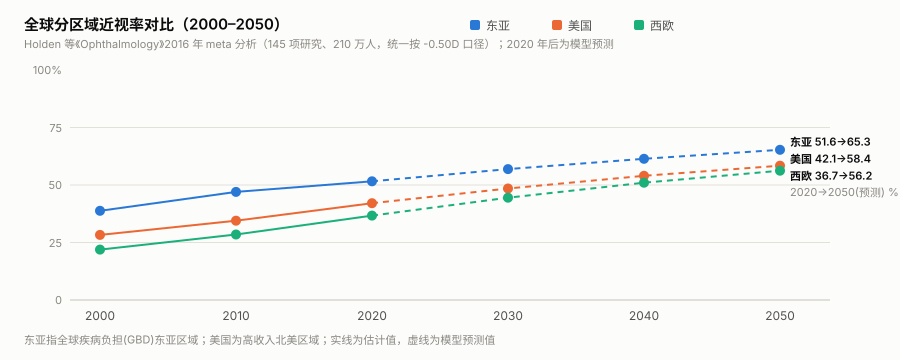
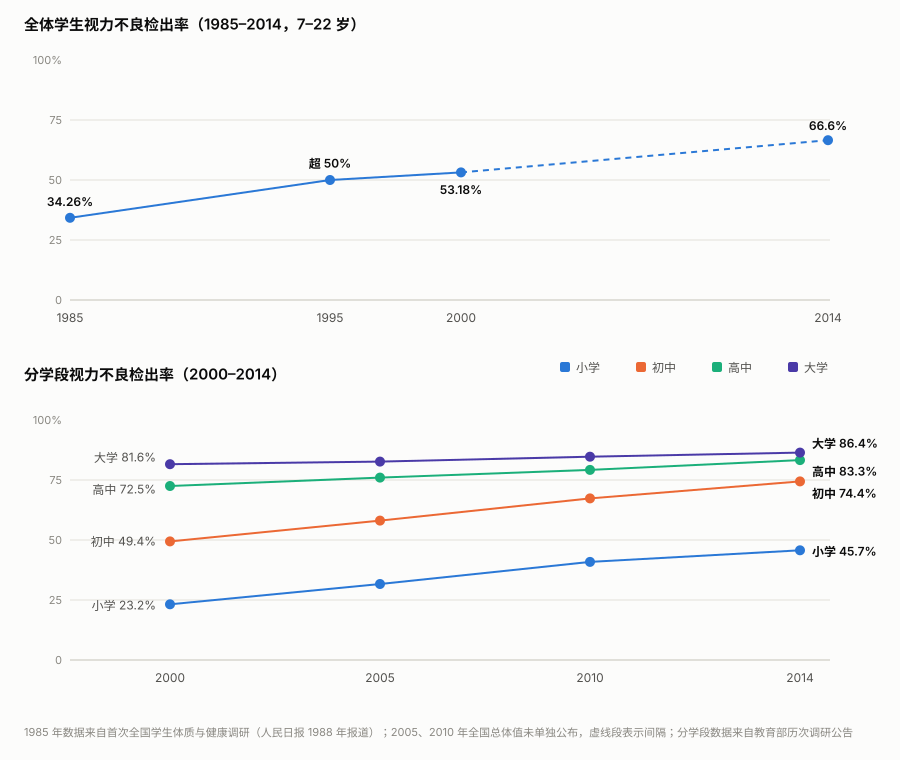
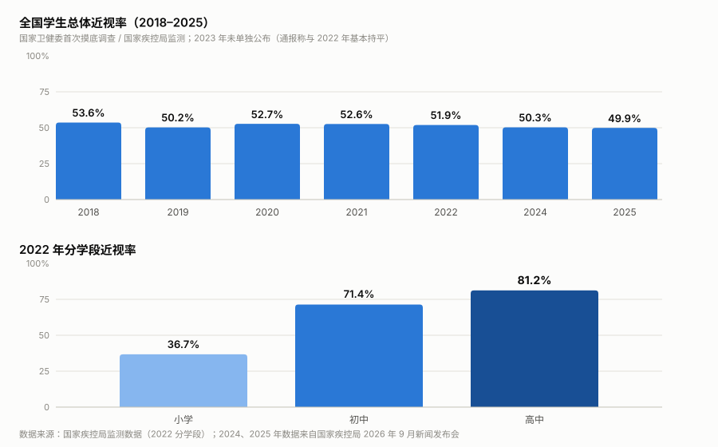

虽然我一直感受得到中国人近视率非常高，我就读于市重点高中，班上 60 人只有 3 人不戴眼镜，上了大学不戴眼镜的人更是稀少。

现在马路上，很多孩子很小就戴上眼镜了，真的看得很刺眼。

前几天看小霸王对美国人的采访，美国人说，只要看到戴眼镜的，那大概率是亚洲人，包括中国、印度、韩国、日本等。

这话确实对，不过我真的很心寒。确实啊，很少看到西方人戴眼镜。为啥中国人那么多戴眼镜？于是好奇的我上网搜索了一下，结果发现中国近视率比我想象的还要严重得多。

放到世界坐标里看得更清楚。Holden 团队 2016 年发表在《Ophthalmology》的全球 meta 分析（145 项研究、210 万人，统一口径）：2020 年东亚近视率 51.6%，美国 42.1%，西欧 36.7%——这就是那位美国人"看到戴眼镜就猜是亚洲人"的出处。而且注意，美国自己也在涨：12–54 岁人群从 1971 年的 25% 涨到 2004 年的 41.6%，三十年涨了三分之二；西欧也在涨。大家都在涨，只是东亚从起点到终点，始终压着全世界最高。

再往回翻，翻到四十年前。1985 年第一次全国学生体质与健康调研（人民日报当年报道）：7–22 岁汉族学生平均视力不良率 34.26%，其中大学生最高年龄组达 74.67%。1995 年，平均数超过 50%。再到口径完全一致的历次调研：小学生视力不良检出率从 2000 年的 23.2% 一路涨到 2014 年的 45.7%，初中生从 49.4% 涨到 74.4%，高中生从 72.5% 涨到 83.3%，大学生 2000 年就已 81.6%、2014 年 86.4%——四十年，全线飘红。2018 年国家卫健委做了第一次全国儿童青少年近视摸底调查：总体近视率 53.6%。到 2025 年，国家疾控局发布：49.9%——小学 36.7%，初中 71.4%，高中 81.2%（2022 年分学段数据）；已经近视的学生里，每十个就有一个是高度近视。也就是说，随便走进一间高中教室，抬头看到的就是一片镜片的反光。这场发布会上，官方把这个成绩叫作"五连降"——从 53.6% 到 49.9%，七年，3.7 个百分点，平均一年降半个多点。而 2018 年那份由八部门联合印发的防控方案，定的 2030 年目标是让高中生近视率"控制在 70% 以下"——治理的"成功"标准，居然是保住七成的底线。

如果只有一部分人近视，那还能说是这部分学生自己不注意用眼，但中国这种震撼的比例，就不只是孩子自己的责任了，这就是中国乃至整个亚洲畸形教育带来的恶性竞争结果。

西方的教育理念是：小孩子的天性就是玩，所以教育主要是通识教育的作用，大部分时间留给学生自己自主探索，等长大到了大学再静下心来往个人感兴趣的方向学习，而且是各方面的，体育、人文、科学技术、音乐等等方面都可以自由选择，大学的头两年都不需要强制选择专业，所以他们的社会各方面都发展的繁荣。我只能说这是真正"适应个人的教育"，是教育真正的意义——让每个人能发挥自己的天分所在。

反观中国呢？不分青红皂白上来就是一顿从小学到高中的应试教育，这不是教育，而是筛选，看看哪个人服从性强。中国有着几百年的科举历史，早已形成了"升官发财"这种比较固化的思维，无法轻易改变。

更好笑的是教育部还想搞双减改革，我们国家就是喜欢管，生孩子要管，居委会要管，他们觉得自己的所有决定都是无比正确的，这套教育制度不改，永远也没办法解决。

我从小学开始就要做一大堆卷子刷题，醒着的一半时间都要近距离看书。没有智能手机的时候还会下去和朋友踢球玩，有了智能手机连娱乐都是智能手机。到了初高中那更叫一个卷呐，中国中学生的世界只有分数和排名。

关键是经过这套毒打的教育体系，到了大学一堆学生突然没了束缚，天天打游戏，多少人就这样混过了大学四年，我是亲眼见到这一幕的。

你要问我如何能避免自己的孩子也被这样的教育体制摧残身体与灵魂呢？我很抱歉，我自己也是这套体制出来的学生，我也知道这套体制有多么的残忍。但目前，除了逃离去到一个没有这套制度的环境，我不知道如何解决。

## 数据来源

- [国家疾控局：我国儿童青少年近视率呈下降趋势（新华社，2024-03-13）](https://www.ndcpa.gov.cn/jbkzzx/c100010/common/content/content_1768152961235197952.html)
- [中国政府网图表页：我国儿童青少年近视率呈下降趋势](https://www.gov.cn/zhengce/jiedu/tujie/202403/content_6939330.htm)
- [教育部转发人民网：降了 1.7 个百分点，"小眼镜"的"大问题"解决得如何了？（含监测方法说明）](http://www.moe.gov.cn/jyb_xwfb/s5147/202406/t20240603_1133754.html)
- [央视网 2026-06-08：“十四五”眼健康工作成效（2024 年 50.3%，四连降）](https://jiankang.cctv.com/2026/06/08/ARTIMmu8H2QreQyrv5QwsayO260608.shtml)
- [人民日报 1988-05-07：首次全国学生体质与健康调查（1985 年数据，7–22 岁平均 34.26%，大学生最高年龄组 74.67%）](https://cn.govopendata.com/renminribao/1988/05/07/3/)
- [中国投影网：全国体质调研显示学生近视率持续上升（1985–2014 系列）](http://www.ty360.com/2017/6/2017_1_81310.htm)
- [教育部 2005 年全国学生体质与健康调研结果公告（含与 2000 年对比数据）](https://hudong.moe.gov.cn/srcsite/A17/moe_943/moe_947/200705/t20070522_80580.html)
- [经济参考报：2014 年全国学生体质与健康调研（小学生 45.71%、初中 74.36%、高中 83.28%、大学生 86.36%）](http://www.jjckb.cn/2017-06/09/c_136351865.htm)
- [Holden 等：Global Prevalence of Myopia... 2000 through 2050（《Ophthalmology》2016，分区域数据表）](https://www.aaojournal.org/article/s0161-6420(16)00025-7/fulltext)
- [美国国家科学院委托论文：Treatment of Childhood Myopia（美国 12–54 岁近视率 1971 年 25% → 2004 年 41.6%，Vitale 2009）](https://nap.nationalacademies.org/resource/27734/Khanal_et_al_Treatment_of_Childhood_Myopia.pdf)
- [教育部等八部门：《综合防控儿童青少年近视实施方案》（2018）](http://www.moe.gov.cn/srcsite/A17/moe_938/s3273/201808/t20180830_345665.html)
- 文中数据图为博主根据上述官方数据自绘
