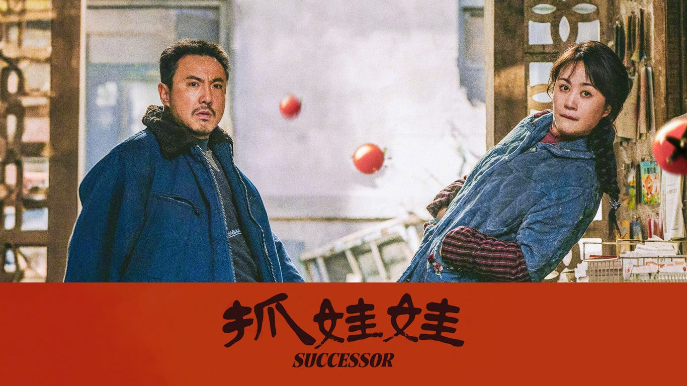
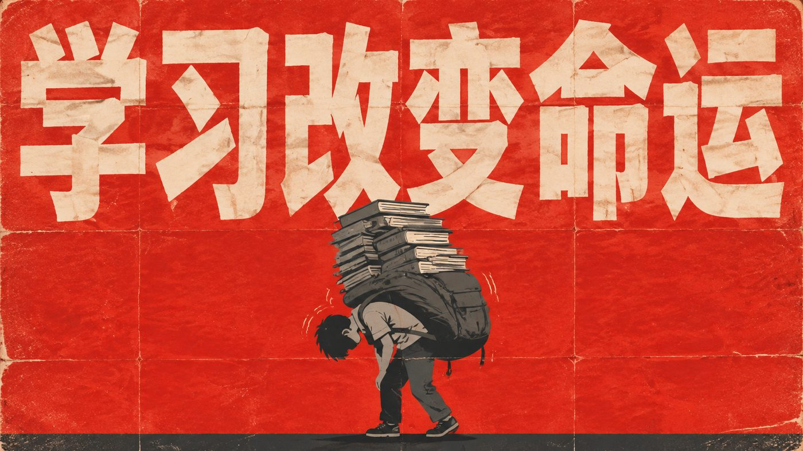
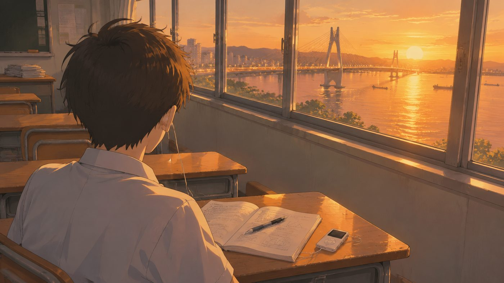

今天我又看了一遍《抓娃娃》。它不仅好笑，更难得的是把中式教育的荒诞揉进了喜剧里。一般来说，一部电影能把一个主题刻画好已经不易，更何况是两种元素（喜剧加中式教育讽刺）的结合——就像《唐人街探案1》把喜剧和探案揉在一起那样，既能吸引观众，又饱含着想表达的内核。

对我来说，这部电影更像是一面镜子。笑过之后，那些荒诞的情节总能勾起我自己在成长、选专业和人际关系里的真实经历。借着这部电影，我想聊聊那些藏在笑声背后的荒诞与痛感。

## 中国式洗脑——学习改变命运

这是贯穿电影的主干，马成钢（沈腾饰演）明明已经很有钱，但是仍然非常死板地认为孩子一定要上牛逼的大学才能算作中国人眼中的“成功”

仔细推敲这句话实际上漏洞百出，但因为中国人从小家庭就开始唠这一出，几乎是根深蒂固、深入人心了。可什么是命运？又如何改变命运？命运不是你想怎样，世界就朝着你想要的方向发展。命运受到很多东西的影响，个人的某次抉择、行动的力度，甚至是偶然遇到的一个贵人，等等。对命运影响的事情太多了，只认为学习好，考上一个牛逼的大学就能让自己的命运往自己想要的方向发展，既荒唐又可笑。确实有很多人靠着学习改变了命运，但我们所看不见的多得多的人读了书也没有跳出自己的阶级，这才是沉默的大多数——我自己就是其中之一。充其量只能说学习是自己人生中的一部分经历，拿极少数人的成功当成普遍规律，不过是典型的幸存者偏差，以偏概全。

那教育的意义究竟是什么？我认为我现在想得比较清楚了，教育的意义，是为每个人发挥自己的天分才干、追求自己的热爱与毕生事业提供帮助。不只是中国，工业革命以来，世界都形成了一种极度追求金钱享乐的氛围，大家普遍觉得好像人的最高追求就是金钱。但事实不是这样的，人真正渴望的其实是快乐与内心的满足。如果去看那些真正感到幸福的人，其中也没有多少是大富大贵的，有的人同样也需要辛勤工作来维持生计，但他们依然觉得生活有滋有味，这是因为真正感到了内心的平静。没有多余的算计，计较，就是单纯的有一份工作，身边能有家人和朋友的陪伴，这就足够了。

所以发现了吗，金钱实际上只是第二位，第一位是自己的热爱，是愿意倾注心血去做的事。在这个基础之上，财富只是水到渠成的附加品。我表妹的大学班主任开学的第一堂课对他们坦言，自己选的机械专业也并不是自己喜爱的，只是当做一份工作来做。我感触很深，因为我自己也是一样，大一的时候非常努力卷绩点然后转到软件工程专业，真正学进去才发现，自己既没有编程的天分，也谈不上多热爱。而在国内的大学体系里，专业一旦选定就极难更改。很多大学生其实都处在这样的无奈里——读着一个并不喜欢的专业，走到一半才发现，这根本不是自己想要的人生。

## 千年前的封建底色

中国有一句古话叫“寒门出贵子”，中国人非常喜欢这句话，但现实中没人会为了这句话而真的“穷养”。为了实现这个执念，马成钢拉着全家人陪演，硬生生给马继业搭了一个破旧、拮据的“穷日子”舞台。说白了，他刻意制造这种落魄，看重的正是那股“从泥里爬出来”的戏剧张力——越是起点低、环境苦，一旦冒出头来，就越显得炸裂。

这句话往深处挖，你会发现中国人迷恋的根本不是什么“成才”，而是极致的“反差”与猎奇。某种程度上，大众骨子里藏着一种隐秘的窥探欲和攀比心，见不得太顺遂、太圆满的事物：你样样都好、顺风顺水，反而激不起多少水花；唯有把“极度的底层/怪异”**和**“极高的光环/逆袭”硬生生焊在一起，才最容易戳中围观者的神经。

看看近几年中国爆火的人：一边是中专背景、一边却在数学竞赛里杀出重围的姜萍；一边是拎着大塑料瓶、生活朴素到近乎刻板的韦东奕；还有网文里动辄“重生开挂、踩着仇人上位”的爽文，以及《凡人修仙传》里资质平庸却靠着死磕一路逆袭的韩立。这些东西之所以能掀起惊涛骇浪，就是因为它们把“普通甚至寒酸”拉到了极致，再让“逆天改命”狠狠撞上去，那种强烈的撕裂感和猎奇感，瞬间就能把所有人的眼球吸过去。

顺着这条线回看“寒门出贵子”，你就会猛然发觉：原来千年前那套讲究出身、执着逆袭与围观反差的底色，到现在其实一点都没变。

## 畸形教育下的另一种摧残：热爱成了奢侈品

几个月前我看完诺兰的《奥德赛》，它直接刷新了我心中的影史第一。当时我花了很多时间去扒幕后制作，尤其是配乐师 Ludwig Göransson 甚至为了契合时代背景去复原古代乐器。那一刻我特别心动，脑子里甚至冒出一个念头：如果我也能去剧组工作，应该会很有趣吧。

而在电影里，为了不让马继业当运动员，马成钢用麻药这个阴招阻挡了马继业的梦想，沈腾听到孩子不能当运动员时的那段拍手戏我每看一遍都要笑🤣，笑归笑，但这个情节在我看来是最讽刺的，马成钢用父亲的形象摧毁了孩子的梦想，这只是中国极小的一个缩影。因为整个中国根本是一个巨大版的“马成钢”，从小就逼孩子学习、不许他追求自己的爱好，以此摧毁他的梦想。

在单一的高考评价体系下，大多数中国家庭和环境都在无形中扮演着“马成钢”的角色——从小只许孩子埋头刷题，把一切课外兴趣视为“不务正业”。孩子们从六岁上小学到十八岁高考，几乎没有时间去接触和体验不同的职业，填报志愿时往往只是对着陌生的专业名称盲选。我们扪心自问一下，我们究竟想要做什么？世界上的大多数人都只是做着一份维持生计的工作，可能连这个问题都没想过。更何况是十八岁的少年？好不容易像马继业这样有了明确的热爱，却又要被长辈的意志亲手掐灭。

想起我高三那年，学业压力大到让我一度觉得自己快抑郁了。那段灰暗的日子里，我偶然听到了《活力工场》的广播节目。从此，每天下午五点一边听广播一边刷题，成了我一天中最期待的时刻。那时候我真切地觉得，播音员是一份特别有魅力的职业，能把温暖和快乐传递给无数刚下班的人，或者像我这样在题海里挣扎的学生。

如今回想起来，那段听着广播的时光之所以让我觉得幸福，正是因为我触碰到了“热爱”的样子。人生真正的意义，不正是去做自己喜欢的事、释放自己的天赋吗？而不是为了名牌大学的头衔或所谓的体面高薪，强迫自己走上一条本不想走的路。

## 中国人之间无处不在的攀比与算计

电影里还有一个场景让我很心酸，当马继业去捡瓶子的时候，几个同学去笑话他，给他编歌曲，把瓶子都丢掉。我看了真的又气又心酸，因为我自己就体验过这种感觉。

没经历过歧视的人应该不懂，中国的歧视其实远比电影里的还要恶毒十万倍。电影里的歧视，笑话和排挤是你可以直观看到的，中国的歧视更恶毒，它是你看不见摸不着的，你只能感受到别人对你的异样眼光。我曾经和一位同学闹过矛盾，后来我真诚地向他道了歉，他也接受了（表面上），平常我们还会正常打招呼，借一些东西也愿意，我当时真的以为真诚的道歉能修复关系，可是后来我总感觉身边的朋友对我有些疏远，于是我找了和我闹矛盾的人的死党（和我关系也比较好），我向他说了我的感受，他一开始不愿意和我说，后来他总算是愿意开口了，这时候我才知道，这个和我闹矛盾的同学平日里一直向他身边的人说我的坏话，让别人不要离我太近。

当时我真的吓瘫了，我根本想象不到表面上对你和蔼可亲，私底下却这样恶毒啊，这也是我第一次真正体会到中国古话“笑面虎”的含义。

中国虽然说是个社会主义国家，但是实际上内部的攀比现象绝对是世界名列前茅的，年纪越大，身边人攀比的东西就越昂贵，比完财富比地位，甚至连下一代也要被纳入比较的筹码。

## 结语

笑声散去之后，电影里的荒诞并没有消失，只是换了一副面孔继续在生活里上演。我们一边吐槽着上一代的执念，一边又在无形的攀比和算计里挣扎，甚至一不留神就活成了自己曾经讨厌的样子。

兜兜转转写了这么多，其实我最想留住的，还是高三傍晚听着广播写题时那种简单的快乐，还有对未知世界依然愿意动心的好奇。钱当然重要，体面也很现实，但如果连自己喜欢什么、想往哪里去都不敢问，那生活未免太憋屈了。或许成长就是从看清这些荒诞开始的——看清之后，依然能在喧嚣和算计之外，守住一点属于自己的真诚、热爱与平静。

感谢阅读！

